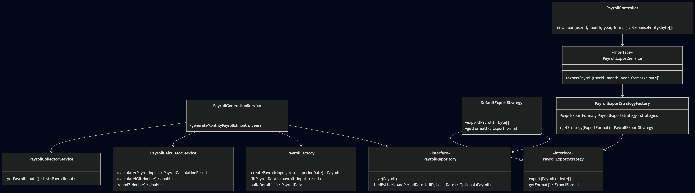

# **Internal Users Management System**

## **Overview :**

The internal users management system is a secure, scalable, and enterprise-grade backend application built with Spring Boot.
This microservice is responsible for managing core employee-related operations within the organization. It handles the complete lifecycle of internal users, including:
* User creation and role assignment
* Department management
* Payroll calculation
* Employee resignation processing

The system ensures structured **role-based access control**, secure authentication, and compliance with organizational policies.
The project follows Clean Architecture principles, industry best practices, and a layered backend structure to ensure maintainability and scalability.


## **Core Features :**
* Create internal users and assign roles
* Deactivate users
* Manage employee lifecycle
* Create departments
* Disable departments
* Assign employees to departments
* Generate payslips
* Calculate salary components
* Monitor payroll history
* Secure payroll access
* Submit resignation requests
* HR review and validation
* Track resignation status
* Maintain resignation history

## **Technology Stack :**

| Category    | Technology              |
|-------------|-------------------------|
| Language    | Java 21                 |
| Framework   | Spring Boot 4.0.2       |
| Build Tool  | Maven                   |
| Database    | PostgreSQL              |
| ORM         | Spring Data JPA         |
| Security    | Spring Security         |
| Validation  | Spring Validation       |
| Boilerplate | Lombok                  |
| Testing     | JUnit, Spring Boot Test |

## **Architecture :**

* Controller Layer → Handles REST API requests
* Service Layer → Business logic & validations
* Repository Layer → Data persistence with JPA
* Security Layer → Authentication & role-based authorization

It also includes :

* DTO layer
* Exception handling layer
* Security filters
* Mapper layer
* Utility layer
* Infrastructure layer (Docker)

This architecture ensures :
* Separation of concerns
* Maintainability
* Scalability
* Clean code structure

## **Security :**
* Role-Based Access Control (RBAC)
* Endpoint protection (not public should have a valid JWT)
* Secure authentication via Spring Security
* Validation of business rules before persistence
* Restricted access to sensitive operations

## **Prerequisites :**

* JDK 21
* Maven 3.3.4
* PostgreSQL 16

## **How to Run :**

1. Clone the repository : **git clone https://gitlab.com/woridgesaas/employe/ms-internal-users-management.git**
2. Build the project : **mvn clean install**
3. Run the application : **mvn spring-boot:run** or run the packaged JAR: **java -jar
   target/attendance-management-0.0.1-SNAPSHOT.jar**

## **Testing :**

Run all tests using : **mvn test**

## **API Base URL :**
* http://localhost:8081/api

## **Project Structure :**

```bash
attendance-management
│
├── config/            # Application configuration classes (Security, CORS, Beans, etc.)
├── controller/        # REST controllers (API endpoints)
├── dto/               # Data Transfer Objects (Request/Response)
├── enumeration/       # Enums
├── exception/         # Global exception handling & custom exceptions
├── filter/            # Security filters (JWT filter)
├── mapper/            # Conversion logic
├── model/             # JPA entities (database models)
├── repository/        # Spring Data JPA repositories
├── service/           # Service layer (Business contracts)
  ├── implementation/  # Service implementations (Business logic methods)      
├── utils/             # Utility classes (Helpers, common reusable logic)
└── resources/         # application.yml/properties, static files, templates
```

## **CI/CD Pipeline :**

This project uses GitLab CI/CD to automate the build, test, and release process following a GitFlow workflow. The pipeline ensures that:
* Every branch is validated
* Only stable code from main generates a release artifact
* Sprint releases are safely stored

## **Pipeline Stages :**

The pipeline consists of three stages : **build → test → package**

#### **1. Build Stage :**

* Compiles the project using Maven (**mvn clean compile**)
* Ensures the code compiles successfully
* Runs on all branches
* Stores temporary build artifacts for internal use

**Purpose :**
Detect compilation errors early and validate project structure.

#### **2. Test Stage :**

* Executes unit tests (**mvn test**)
* Uses compiled output from the build stage
* Runs on all branches

**Purpose:**
Validate business logic and prevent regressions.

#### **3. Package Stage :**

* Generates the final executable .jar file (**mvn package -DskipTests**)

Runs only when:
* A Merge Request targets the main branch or a commit is pushed directly to main
* Produces a permanent release artifact : **attendance-management-release**

**Purpose :**
Ensure that only stable and validated code produces official application releases.

## **Performance Optimization :**
The pipeline includes :
* Maven dependency caching (**.m2/repository**)
* Artifact reuse between stages (**needs**)
* Controlled artifact retention policy

This improves build performance and ensures efficient CI execution.

# 📄 Payroll Module – Woridge Payroll

**Technical Documentation**  
Version: 1.0 | Last updated: March 20, 2026

---

## 1. Introduction & Purpose

The **Woridge Payroll** module is responsible for generating employee payslips, in compliance with Moroccan social and tax regulations (CNSS, AMO, IGR, CIMR).

It is designed to cover two use cases:

| Mode | Trigger | Usage |
|------|---------|-------|
| **Automatic (batch)** | Cron job triggered on the 26th of each month | Bulk generation of payslips for all active employees |
| **On-demand (manual)** | HR request via the interface | One-off download of a payslip for a given employee |

📌 **Key technical constraint**:  
The PDF is never physically stored on the server. It is generated *on‑the‑fly* from persistent data, then returned to the browser as a `byte[]`. This ensures security, lightweight operation, and no redundant data.

---

## 2. General Architecture
[Collection] → [Calculation] → [Persistence] → [Export] → [Display]

↑ ↑ ↑ ↑ ↑

Collector · Calculator · Factory · Strategy · Controller

The flow is orchestrated either by the **application service** `PayrollGenerationService` (batch) or by the **controller** `/download` (on-demand).

---

## 3. Collection & Calculation Phase (the engine)

### 3.1. `PayrollCollectorService`

**Role**: Aggregate all necessary data for payroll calculation for an employee, at a given period.

#### Data collected
- **Identity**: name, CIN, CNSS, position, department
- **Contractual salary**: `baseSalary`
- **Attendance**: worked days (`workedDays`)
- **Absences**: unjustified absence days
- **Overtime hours**: broken down by category (25%, 50%, 100%)
- **Bonuses**: total monthly bonuses
- **Family information**: number of dependents (`familyDeductions`)

#### Output
A `PayrollInput` object containing all raw data required for calculation.

---

### 3.2. `PayrollCalculatorService`

**Role**: Apply Moroccan tax and social rules to produce payroll results.

#### Calculation steps

1. **Effective salary**  
   `effectiveBaseSalary = (baseSalary / 26) * workedDays`
2. **Overtime value**
3. **Gross salary (SB)**  
   `totalBrut = effectiveBaseSalary + totalOvertimeMAD + bonus`
4. **Social contributions**
   - CNSS: `min(totalBrut, 6000) × 4.48%`
   - AMO : `totalBrut × 2.26%`
5. **Professional expenses (FP)**  
   `min(totalBrut × 25%, 2500)`
6. **Net taxable salary (SNI)**  
   `SNI = totalBrut – CNSS – AMO – FP`
7. **IGR (progressive scale)**  
   According to Moroccan monthly brackets:
   - 0%    : ≤ 3,333.33 MAD
   - 10%   : 3,333.34 – 5,000
   - 20%   : 5,000.01 – 6,666.67
   - 30%   : 6,666.68 – 8,333.33
   - 34%   : 8,333.34 – 15,000
   - 37%   : > 15,000
8. **Family deductions**  
   `familyDeduction = min(nbPersons, 6) × rate`
9. **Net IGR**  
   `IGRnet = max(0, IGRbrut – familyDeduction)`
10. **Net salary payable**  
    `netAPayer = totalBrut – (CNSS + AMO + IGRnet)`

#### Output
A `PayrollCalculationResult` object containing all detailed amounts (base, gross, contributions, IGR, net…).

---

### 3.3. `PayrollFactory`

**Role**: Build a complete JPA `Payroll` entity from a `PayrollInput` and the calculation result.

#### Process
- Creates the parent `Payroll` object
- Adds detail lines (`PayrollDetail`) via `fillPayrollDetails()`

#### Line types
| Type     | Description |
|----------|-------------|
| `GAIN`   | Salary, bonuses, overtime |
| `RETENTION` | CNSS, AMO, IGR |
| `FISCAL` | Professional expenses, family deductions |
| `INFO`   | SBI, SNI |

---

## 4. Persistence Phase

**Component**: `PayrollRepository` (Spring Data JPA)

### Storage
- The parent `Payroll` entity is saved.
- Thanks to `CascadeType.ALL`, `PayrollDetail` entries are automatically persisted.

### Benefit
- Payroll is **frozen** in time. Even if source data (absences, overtime) changes after the 26th, the payslip remains unchanged.

---

## 5. Export & Rendering Phase (JasperReports)

### 5.1. On-demand download workflow

1. **Controller**
   - Endpoint: `/download`
   - Receives the HTTP request and delegates to the export service.

2. **PayrollExportService**
   - Main service orchestrating the export.
   - Calls the factory to select the appropriate strategy.

3. **PayrollExportStrategyFactory**
   - Selects the export strategy (here: PDF).
   - Returns the corresponding implementation.

4. **DefaultExportStrategy**
   - Default implementation for PDF export.
   - Uses JasperReports to generate the content.

5. **JasperReports**
   - Generates the report in memory (`byte[]`).
   - The binary stream is returned in the HTTP response.



